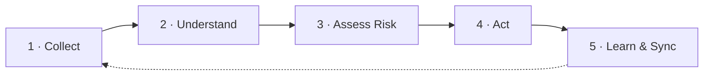
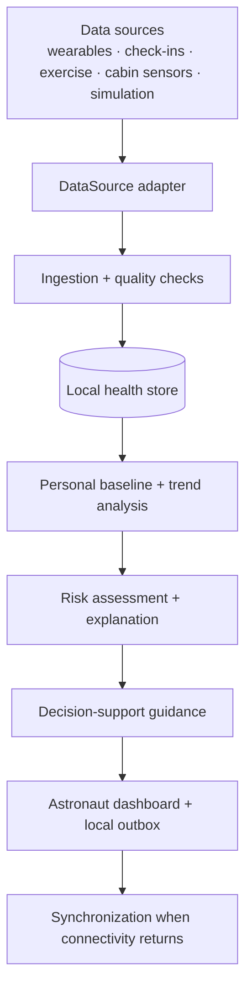
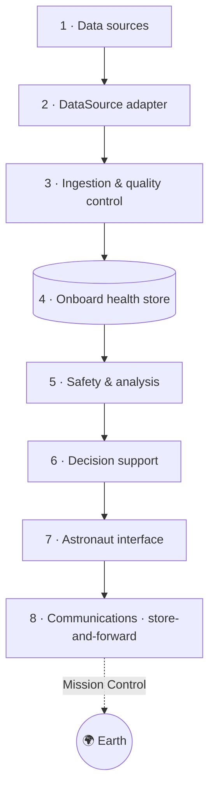

<div align="center">

# 🛰️ ORBIT Health OS

### Earth-independent health intelligence for astronauts

**Early warnings. Clear explanations. Safe actions — even when Earth can't answer.**

<br>


<br>

[**Live Demo**](#-project-links) · [**Demo Video**](#-project-links) · [**Architecture**](#-architecture) · [**Evaluation**](#-evaluation--reliability) · [**Limitations**](#-safety-ethics--limitations)

</div>

---

> **🎯 Challenge:** *Create Health Monitoring Software for Astronauts on Space Missions* — NASA Space Apps Challenge 2026

> ⚠️ **ORBIT Health supports medical decision-making. It does not diagnose conditions, prescribe treatment, or replace medical professionals.**

---

## 📑 Table of Contents

- [Overview](#-overview)
- [The Problem](#-the-problem)
- [Our Solution](#-our-solution)
- [Key Features](#-key-features)
- [How It Works](#-how-it-works)
- [Risk States](#-risk-states)
- [Demonstration Scenarios](#-demonstration-scenarios)
- [Architecture](#-architecture)
- [Technology Stack](#-technology-stack)
- [Evaluation & Reliability](#-evaluation--reliability)
- [Data & Scientific References](#-data--scientific-references)
- [Safety, Ethics & Limitations](#-safety-ethics--limitations)
- [Repository Structure](#-repository-structure)
- [Getting Started](#-getting-started)
- [Roadmap](#-roadmap)
- [Project Links](#-project-links)
- [Team](#-team)
- [Acknowledgements](#-acknowledgements)

---

## ✨ Overview

**ORBIT Health** is an **offline-first** health monitoring and decision-support prototype that helps astronauts understand health-related observations and make informed onboard decisions during long-duration and deep-space missions — especially when communication with Earth is delayed or unavailable.

It brings crew check-ins, physiological observations, exercise and performance records, and spacecraft-environment data into **one operational view**. It checks data quality, compares each astronaut against **their own baseline**, analyzes trends and configured safety rules, and presents **explainable risk states** with clear next-step guidance.

| | |
|---|---|
| 🌍 **Earth-independent** | Core assessment and guidance run locally, with no live link required |
| 🧠 **Explainable** | Every alert says *what changed*, *why it matters*, and *what to do next* |
| 👤 **Personal** | Each astronaut is compared to their own normal, not a population average |
| 🛡️ **Safety-first** | Missing or unreliable data is never silently treated as healthy |

---

## 🚨 The Problem

| Challenge | Why it matters |
|---|---|
| 📡 **Comm delays & outages** | Deep-space latency or loss of contact removes real-time support from Earth |
| 🧩 **Scattered data** | Wearables, cabin sensors, exercise logs, and manual check-ins live in separate places — no single view |
| 🐢 **Slow-developing risks** | Radiation exposure, bone/muscle loss, sleep disruption, fluid shift, and SANS develop gradually and are easy to miss |

> Without a unified onboard view, meaningful changes are hard to recognize and interpret quickly. **Astronauts need trustworthy decision support on board.**

---

## 💡 Our Solution

ORBIT Health runs a continuous five-stage loop:



1. **Collect** observations from supported sources, crew check-ins, exercise records, and environmental inputs.
2. **Understand** data quality, personal baselines, and longitudinal trends.
3. **Assess risk** using transparent safety rules and trend analysis.
4. **Act** by presenting relevant guidance and pathways to approved procedures.
5. **Learn & synchronize** by preserving records and syncing queued information when communication returns.

---

## 🧭 Key Features

### 🖥️ Unified Crew Dashboard
Crew status, health indicators, mission context, alerts, and communication status in a single view.

### 🧍 Interactive 2D Body Map
A **navigation aid**: select a region to see related monitoring domains, indicators, trends, active alerts, and linked guidance. *It does not diagnose or localize disease.*

### 🔍 Explainable Risk Assessment
Combines data-quality checks, personal-baseline comparison, trend and persistence analysis, critical safety overrides, and evidence-based explanations — always showing data quality and uncertainty.

### 📴 Offline-First Operation
Monitoring, assessment, records, and guidance keep working during outages. A durable **store-and-forward queue** preserves outbound records for later synchronization.

### 🎛️ Judge Control Panel
Trigger scenarios, interrupt communications, inject sensor faults, and inspect system responses live.

### 🤝 Adherence-Focused Engagement
Recognizes check-ins and completion of approved exercise. **Symptom reporting is never scored or penalized**, and there are no competitive health leaderboards.

---

## ⚙️ How It Works



The **DataSource adapter** separates input formats from the assessment engine. Synthetic, CSV, and replay source patterns let new data sources connect **without rewriting the risk engine or the interface**.

---

## 🚦 Risk States

| State | Meaning |
|:---:|---|
| 🟢 **GREEN** | No configured alert is active for available, sufficiently reliable data |
| 🟡 **AMBER** | A pattern warrants attention or monitoring |
| 🟠 **ORANGE** | A significant warning that requires review and the relevant next step |
| 🔴 **RED** | A critical configured trigger requiring urgent attention and the applicable escalation pathway |
| ⚪ **GRAY** | Data is missing, unreliable, stale, or unavailable — **a healthy state cannot be assumed** |

> Risk is always communicated with **color + icon + text label**, never color alone.
> **Missing or unreliable information must never silently become GREEN.**

### Anatomy of an alert

```text
┌─────────────────────────────────────────────┐
│  🟠 ORANGE — Warning                        │
│  ───────────────────────────────────────    │
│  What changed    →  the observed pattern    │
│  Why it matters  →  the possible implication│
│  Next action     →  approved procedure link │
│  Evidence        →  graphs · sources · notes│
│                     (expand on demand)      │
└─────────────────────────────────────────────┘
```

---

## 🎬 Demonstration Scenarios

> All numeric values below are **illustrative demonstration values**, not clinical thresholds.

| Scenario | Trigger | What it demonstrates |
|---|---|---|
| **A — Muscle, metabolic & fatigue trend** | Reduced exercise performance/completion + shorter sleep + rising fatigue | Baseline comparison, persistence analysis, explainable **🟠 ORANGE** warning |
| **B — Radiation event & vigilance change** | Declared radiation event or dosimeter trend + a seeded change in a sustained-attention task or fatigue report | Evidence combination and critical-rule behavior. *A vigilance change alone is not intended to create RED* |
| **C — Cabin hazard during comm loss** | Simulated cabin-environment hazard while communications are unavailable | Local monitoring, unavailable eye data shown as **⚪ GRAY**, deduplicated sync after reconnection |

**Fault demonstrations:** disable or corrupt a sensor, inject noisy or invalid data, and show **uncertainty instead of false reassurance**.

---

## 🏗️ Architecture

An **eight-layer, offline-first** architecture:



| # | Layer | Responsibility |
|:-:|---|---|
| 1 | **Data sources** | Wearables, medical devices, crew check-ins, exercise equipment, cabin sensors, simulation inputs |
| 2 | **DataSource adapter** | Isolates source formats from the rest of the system |
| 3 | **Ingestion & QC** | Normalizes units/timestamps; handles missing, stale, duplicate, and out-of-order records |
| 4 | **Onboard health store** | Local persistence for observations, baselines, event history, audit records, outbound queue |
| 5 | **Safety & analysis** | Configured rules, baseline and trend analysis, anomaly handling, confidence, uncertainty |
| 6 | **Decision support** | Risk state, explanation, procedure pathway, escalation |
| 7 | **Astronaut interface** | Dashboard, alerts, trends, check-ins, body map, guidance |
| 8 | **Communications** | Prioritized store-and-forward synchronization with Mission Control |

### 🔄 Offline synchronization

**Transmission, delivery, and acknowledgement are separate states.** A transmission attempt is not proof that Mission Control received or acknowledged a record. On reconnection, queued records synchronize **without duplication or loss**.

---

## 🧰 Technology Stack

> The master blueprint specifies the intended stack. Confirm against the final repository before treating every item as part of the delivered build.

| Area | Technology |
|---|---|
| **Backend** | Python 3.11 · FastAPI |
| **Data contracts** | Pydantic |
| **Data processing** | pandas · NumPy |
| **Local storage** | SQLite |
| **Frontend** | React + Vite |
| **Charts** | Chart.js |
| **Offline interface** | Service worker / Progressive Web App |
| **Testing** | pytest |

---

## 📊 Evaluation & Reliability

Evaluation is based on **seeded simulations and fault injection**.

| Metric | Definition |
|---|---|
| ⏱️ **Detection latency** | Time from simulated event onset to the first alert at or above the expected state |
| 🎯 **Detection rate** | Share of seeded runs where the expected pattern is detected at the expected state |
| 🔕 **False-alert count** | Alerts above GREEN per simulated mission-day in no-anomaly runs |
| 🧪 **Fault robustness** | Behavior with noisy, missing, duplicated, or out-of-order observations |
| 🔁 **Synchronization integrity** | Records sent, received, duplicated, or lost across outage/reconnection cycles |

> **Measured, not claimed.** Results come from actual runs — never hard-coded, and never presented as clinical performance.
>
> 📄 Evaluation report: `[Add link to docs/eval_results.md]`

---

## 🔬 Data & Scientific References

### NASA Open Science Data Repository (OSDR)

| Study | Research context | Relevance & limitation |
|---|---|---|
| [**OSD-684**](https://osdr.nasa.gov/bio/repo/data/studies/OSD-684) | Human skeletal muscle tissue-chip research on spaceflight-related changes in fiber type and metabolic gene expression | Muscle-health context. *Not a wearable feed or clinical predictor* |
| [**OSD-816**](https://osdr.nasa.gov/bio/repo/data/studies/OSD-816) | Ex vivo human ocular model investigating mechanisms related to spaceflight-associated neuro-ocular syndrome (SANS) | Ocular/SANS context. *Not a live astronaut eye measurement or cabin sensor feed* |
| [**OSD-939**](https://osdr.nasa.gov/bio/repo/data/studies/OSD-939) | Rodent sustained-attention and dopaminergic-protein research following proton-radiation exposure | Cautious vigilance-scenario context. *Not proof of human outcomes or a human prediction model* |
| [**OSD-1010**](https://osdr.nasa.gov/bio/repo/data/studies/OSD-1010) | Human gut-on-chip research on epithelial responses to space-relevant heavy-ion irradiation | GI mechanism context. *Not a radiation dosimeter feed* |

> **Data interpretation:** These studies are **research evidence, not real-time astronaut vital-sign streams.** Molecular, tissue-chip, ex vivo, and rodent measurements are never converted into astronaut observations without an approved, scientifically valid mapping.
>
> **Provenance** preserves: study/version, model, sample, assay, source file/column, original unit, transformation, and access/license status.

### BRSMPT Campaign 1 Ares

Cognitive-performance records, including subject records and tasks such as **Simple Reaction Time**, **Running Memory**, **Matching to Sample**, and mRTC-related records. These provide cognitive-performance research context and are **not** represented as live physiological sensor data or as measurements from the named demo crew.

---

## 🛡️ Safety, Ethics & Limitations

ORBIT Health is a **software prototype for demonstration and research exploration.**

- ✅ Prototype thresholds, trigger windows, and scenario values are **illustrative**
- ✅ Missing, stale, invalid, or unreliable data is **surfaced explicitly**
- ✅ Symptom reporting is **never penalized** or used as a negative gamification score
- ✅ Passive data is **not used to infer psychiatric conditions**
- ❌ **Not** a clinically validated or operationally approved medical device
- ❌ **Does not** diagnose, prescribe, or replace qualified medical or mission personnel
- ❌ Research datasets are **not** treated as direct astronaut sensor feeds
- ❌ Prototype security controls **do not** establish operational security certification
- 📋 Procedures and countermeasures must be supplied and validated by responsible mission authorities
- 🩺 Requires **space-medicine expert review** before any real-world use

---

## 🗂️ Repository Structure

> Logical structure proposed in the master blueprint — update it to match the final repository.

```text
orbit-health/
├── backend/
│   ├── app/
│   │   ├── contracts/     # Pydantic data contracts
│   │   ├── sources/       # DataSource adapters (synthetic · CSV · replay)
│   │   ├── ingestion/     # Normalization + quality checks
│   │   ├── store/         # SQLite persistence + outbox
│   │   ├── baseline/      # Personal baselines
│   │   ├── risk/          # Risk engine + explanations
│   │   ├── guidance/      # Playbooks / countermeasures
│   │   ├── sync/          # Store-and-forward sync
│   │   ├── scenarios/     # Demo scenarios A · B · C
│   │   └── api/           # FastAPI routes
│   ├── config/
│   ├── tests/
│   └── eval/              # Seeded evaluation harness
├── frontend/
│   ├── src/
│   │   ├── components/
│   │   ├── pages/
│   │   ├── api/
│   │   ├── charts/
│   │   └── bodymap/
│   └── public/
├── docs/
│   ├── architecture.md
│   ├── demo_script.md
│   ├── judge_qa.md
│   └── eval_results.md
└── README.md
```

---

## 🚀 Getting Started

> ⚠️ The blueprint defines the stack and logical modules, but **not** final entry-point names, package scripts, environment variables, or deployment configuration. **Do not publish guessed commands** — fill in and verify each step against the final repository so reviewers can reproduce the demo.

```bash
# 1. Install backend dependencies
#    TODO: [add verified command]

# 2. Start the backend API
#    TODO: [add verified command]

# 3. Install frontend dependencies
#    TODO: [add verified command]

# 4. Start the frontend dashboard
#    TODO: [add verified command]

# 5. Run automated tests
#    TODO: [add verified command]

# 6. Launch demo scenarios and the offline / reconnection flow
#    TODO: [add verified command]
```

---

## 🧭 Roadmap

- [ ] Adapter for real data sources (wearables, medical devices, cabin sensors)
- [ ] Expert-reviewed protocols and countermeasure library
- [ ] Crew usability testing
- [ ] Expanded evaluation across longer simulated missions
- [ ] 🌍 **Earth benefit:** adapt for remote, low-connectivity healthcare

## Team

**`[Add team name]`** — NASA Space Apps Challenge 2026

| Name | Role | Links |
|---|---|---|
| `Jana Mahmoud` | `Team Leader | Researcher | Frontend Developer` |
| `Malak Osama` | `Backend Developer`|
| `Hana Khaled` | `Backend Developer` |
| `Mariam Mahmoud` | `Data Analysis` |
| `Ganna Radwan` | `Presentation Designer & Content Coordinator` | 

---

##  Acknowledgements

We acknowledge **NASA's Open Science Data Repository** and the researchers whose published studies provide scientific context for this prototype. The cited studies are used within their stated research scope and limitations.

---

<div align="center">

** Built for a future where space exploration goes farther — and astronaut health remains a priority.**

*Not a doctor. A trustworthy teammate.*

</div>
